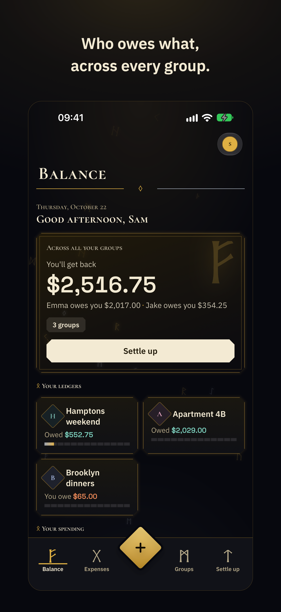
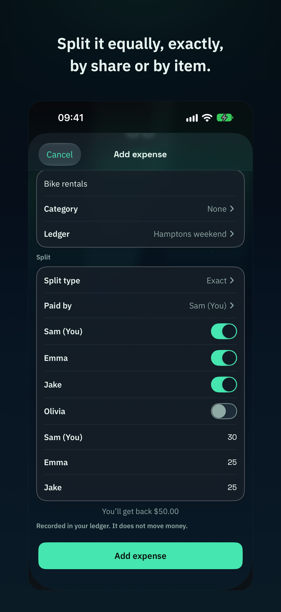
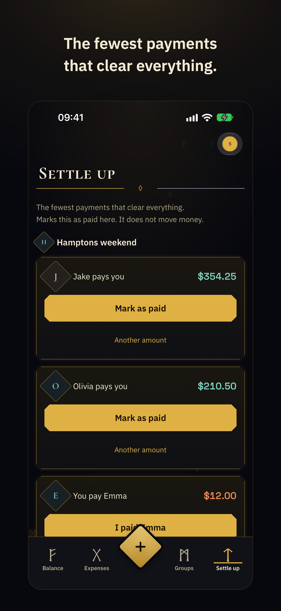
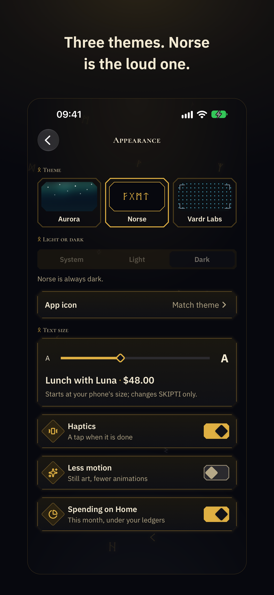
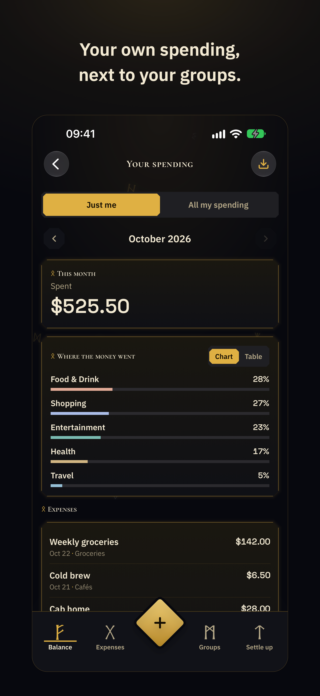
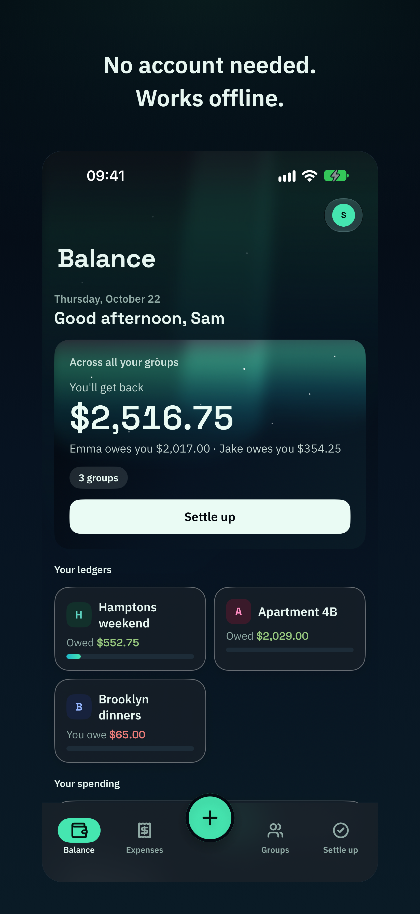

# SKIPTI

Local-first personal finance and shared expense splitting. iOS, Android.
Apache-2.0. No subscriptions, no ads, no telemetry. Your ledger lives encrypted
on your phone; with an account, it and your groups sync through SKIPTI's cloud
on Google Firebase (not end-to-end encrypted: see THREAT_MODEL.md).

> Old Norse *skipti*: a division, a share-out, an exchange.

SKIPTI was written collaboratively by Prithvi Saha (Vardr Labs) with Claude
Code (Anthropic) and GLM 5.3 Flash (Ox Alpha). Design, architecture, the
security model and every decision about what ships were human; a large share of
the implementation, the test suites and the audit passes were written with AI
assistance, and every change must pass the project's full local gate (tests,
deliberate-failure checks and supply-chain audits) before it lands.

**Status:** pre-release. The design of record is `docs/SPEC.md`
(spec version 1.0, design freeze candidate). Implementation follows its phase
gates; nothing here should be trusted with real money until the gates in
SPEC §15 are signed off.

## What it looks like

<table>
<tr>
<td width="33%"><a href="docs/images/readme-01-home.png"></a></td>
<td width="33%"><a href="docs/images/readme-04-split.png"></a></td>
<td width="33%"><a href="docs/images/readme-05-settle-up.png"></a></td>
</tr>
<tr>
<td width="33%"><a href="docs/images/readme-07-themes.png"></a></td>
<td width="33%"><a href="docs/images/readme-08-your-spending.png"></a></td>
<td width="33%"><a href="docs/images/readme-09-offline.png"></a></td>
</tr>
</table>

## Guarantees

See [GUARANTEES.md](GUARANTEES.md): no subscription, no ads, no telemetry;
no caps on logging expenses; no paid tiers; full open-format export in one
tap; your own ledger fully functional offline with no account; no third-party
network origins beyond SKIPTI's cloud, sign-in and notifications; only you and
your groups' members can read your data.

The precise limits of that last claim are published in
[THREAT_MODEL.md](THREAT_MODEL.md), including the sections most products omit.

## Layout

| Path | What |
|---|---|
| `core/` | `skipti-core` (Rust): `lykill` randomness · `skrin` encrypted store · `norn` ledger · `hlutr` splits · `straumr` records · `merki` categorisation · `flutningr` import and export |
| `firebase/` | The Firebase project: the Firestore and Storage security rules and their refusal tests, the Cloud Functions and theirs (all run in the emulators by the full gate), the Hosting files (the `/join` invite page, the privacy policy and the app-link files) and the operator's approvals page (`firebase/admin/`, its own site), pinned CLI |
| `web/` | *(not started: brand fonts only; the PWA shell is planned, not built)* |
| `ios/` | SwiftUI shell |
| `android/` | Kotlin/Compose shell (one build, the `play` flavour) |
| `docs/adr/` | Architecture decision records |

## Verifying the apps

**Android.** SKIPTI on Google Play is signed with this certificate (SHA-256):

`57:F3:A1:0F:A2:62:19:1C:AF:25:0F:DC:6F:E5:34:83:79:FE:9A:C8:77:9D:B2:BE:5C:0C:78:2B:97:30:42:F1`

Installs from before Google rotated SKIPTI's signing key (September 2026) carry the previous one:
`ED:82:04:58:8C:25:8C:1C:CA:C0:FC:44:A9:AF:0E:15:FC:18:5E:0C:04:5B:F5:9A:4D:67:66:13:0F:CC:0C:7D`.

To check an APK, run `apksigner verify --print-certs SKIPTI.apk` (Android SDK build-tools): its
"certificate SHA-256 digest" must be one of these, printed in lower case without colons. The upload key, which
only sends builds to Google Play and never reaches users, is
`41:84:18:7C:C0:98:70:8D:DE:01:7B:86:C9:5C:D4:1C:41:E8:E6:82:D6:3F:D7:96:36:70:D4:18:40:AD:3A:0E`.
The same three values are published at `https://skipti.vardrlabs.com/.well-known/assetlinks.json`, so this
repository and the domain vouch for each other.

**iOS.** Apple re-signs App Store builds, so there is no certificate to compare. The App Store lists the seller as
Vardr Labs LLC, and the app's Team ID is `27GK2T7UCT`, the same ID the domain's
`/.well-known/apple-app-site-association` names.

## Development

```
make test     # core tests
make clippy   # lint, zero warnings
make audit    # cargo audit + cargo deny + npm audit
```

## Licence

Apache-2.0. See [LICENSE](LICENSE) and [NOTICE](NOTICE); the reasoning lives in [docs/adr/0020](docs/adr/0020-apache-2.0.md).
